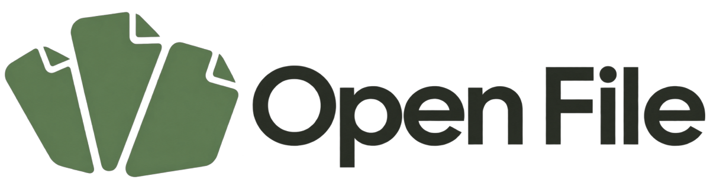
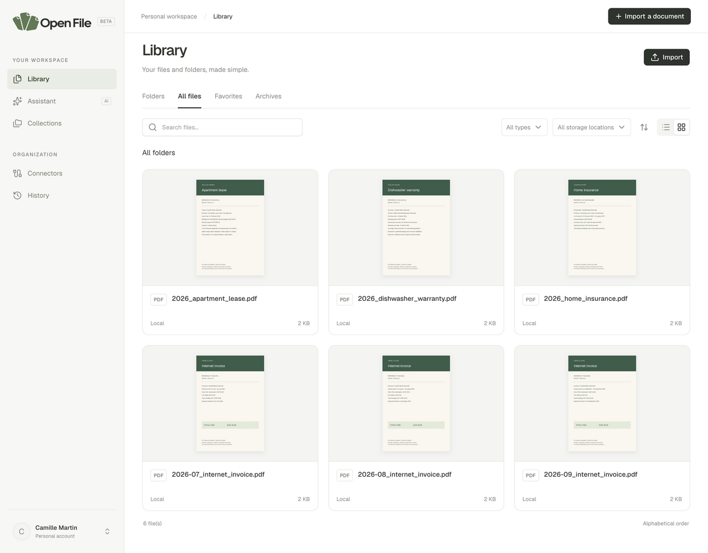
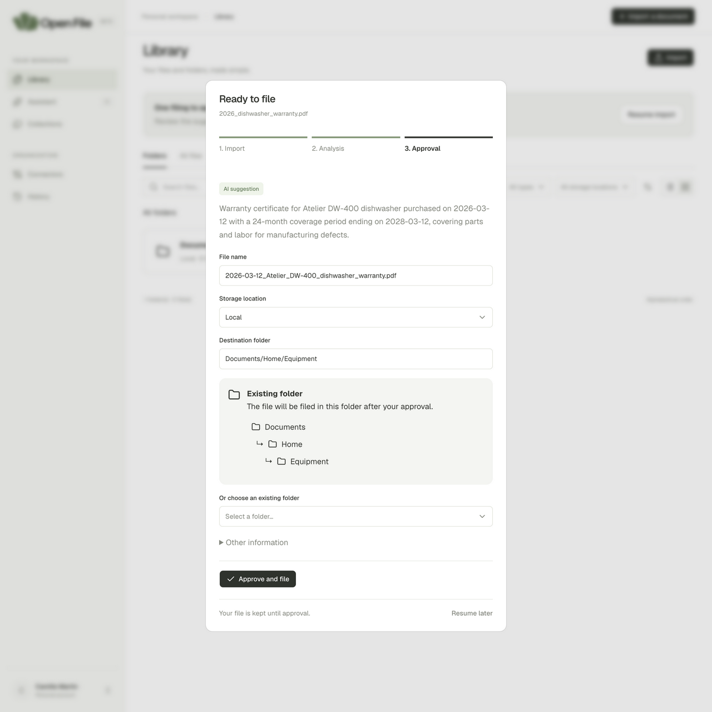
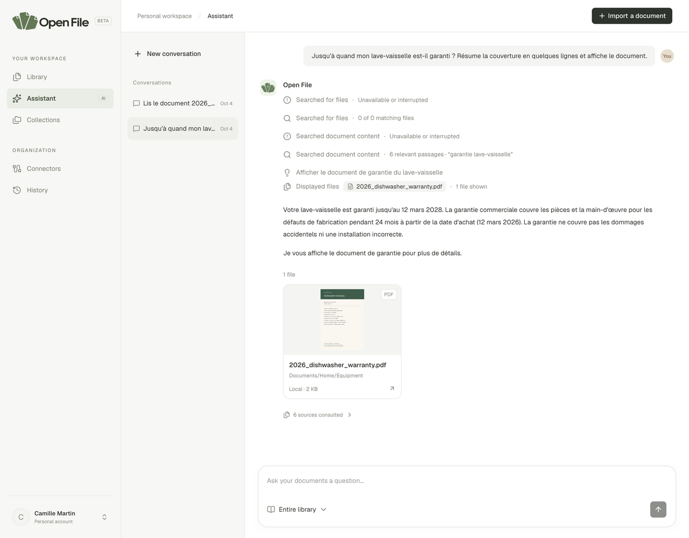

<p align="center">
  
</p>

<h1 align="center">A little less paperwork.</h1>

<p align="center">Import your documents, approve their filing, and find answers with an assistant that cites its sources.</p>

<p align="center"><a href="LICENSE">MIT License</a> · Self-hosted · Local storage or Google Drive · Optional AI</p>



Open File is a personal document management application. Each account has its own
library, connections, and AI settings. The interface is in English; documents and
questions can also be in French.

## What you can do

- **Import and file** PDFs, images, and text files. AI suggests a name, metadata,
  and a folder; you edit and approve them before filing.
- **Organize** by folders, tags, favorites, and collections, in list or grid view.
- **Preview documents**, edit their information, and review actions in the history.
- **Ask questions about your documents** with a conversational assistant: sourced
  answers, file cards, activity tracking, and persistent conversations.
- **Choose your storage**: local to the server or Google Drive, independently of AI.
- **Work without AI**: local extraction of text-based PDFs and TXT files, manual
  filing, and text search, with no external provider key.

| Without AI                                        | With AI enabled                        |
| ------------------------------------------------- | -------------------------------------- |
| Import, previews, folders, tags, and collections  | All features available without AI      |
| Local extraction of text-based PDFs and TXT files | Extraction from scans and images       |
| Manual filing                                     | Suggested names, folders, and metadata |
| Text search                                       | Semantic search and contextual answers |

AI uses each user's OpenAI key and billing account. The required content is sent
to that provider when AI is enabled. Originals remain on the selected storage;
extracted text and conversations are stored in the database.

## Quick start

Prerequisites: Docker Engine with Docker Compose, and Node.js to generate secrets
(Node 22.18+ within the 22.x branch, or 24.11+; the project's version is in `.nvmrc`).
From the project directory:

```bash
node scripts/setup.mjs
docker compose up --build -d
docker compose ps
```

Open **http://localhost:3000**, create an account using the invitation code from
`SIGNUP_TOKEN` in your private `.env`, and click **Import a document**.
For an existing installation, follow the [security migration](docs/security-hardening.md) before rebuilding.
You can use the [six fictional PDFs](examples/README.md).
No AI key or Google connection is required to get started.

To enable AI: go to **Settings → Automatically with AI**, enter your key, choose
a model available to your account, then click **Save and enable AI**.
Saving the key alone does not enable AI mode.

Data persists in the `postgres` and `files` Docker volumes. Also back up `.env`,
especially `ENCRYPTION_KEY`. The setup script preserves an existing `.env` file.
Never publish this file.

## Explore the application

### Review before filing

The import dialog stays open during analysis. You can edit the suggestion before
clicking **Approve and file**. **Resume later** lets you continue without uploading
again.



### Answers linked to your documents

The assistant can find information, read a clause, count files, or display
invoices. Its sources open the relevant documents.



All screenshots show the fictional Camille Martin account and the documents
provided in `examples/`. The AI answer was generated from these documents through
the real backend; the screenshots are not mockups.

## Documentation

| Guide                                                  | Contents                                                 |
| ------------------------------------------------------ | -------------------------------------------------------- |
| [Installation and configuration](docs/installation.md) | Docker, environment variables, development, Google Drive |
| [Using Open File](docs/usage.md)                       | Import, library, collections, assistant, and screenshots |
| [Reproducible demo](examples/README.md)                | Fictional PDFs, generation, and sample questions         |
| [Document assistant](docs/assistant.md)                | Tools, sources, scopes, and limits                       |
| [Architecture](docs/architecture.md)                   | Services, data, ports, and adapters                      |
| [API](docs/api.md)                                     | Authentication, routes, and formats                      |
| [Operations](docs/operations.md)                       | HTTPS, backups, updates, and troubleshooting             |
| [Contributing](CONTRIBUTING.md)                        | Conventions and checks                                   |

## Current scope

Formats: **PDF, PNG, JPEG, WebP, and UTF-8 TXT**, up to **5 files of 20 MiB each**
per import. Word, Excel, and OneDrive are not supported. Google Drive stores files
imported through Open File; it does not automatically import an existing Drive or
watch its folders.

This version does not provide team workspaces, password recovery by email, account
deletion in the interface, or external notifications. Document deletion is
available and schedules cleanup of the original; archiving keeps the file.

Registration is open. Before deploying an Internet-facing instance, read the
[operating requirements](docs/operations.md). AI answers and filing suggestions
must be checked; they do not guarantee the accuracy of document contents.

## Stack and license

Next.js 16 / React 19 · Express 5 · PostgreSQL 17 with pgvector · Better Auth ·
AI SDK · TypeScript · pnpm / Turborepo.

Distributed under the [MIT License](LICENSE). The fictional documents and their
generator are included under the same license. Dependencies retain their own licenses.
