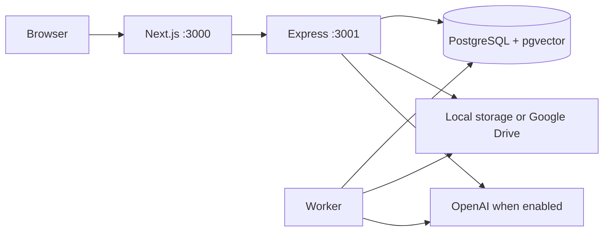

# Architecture

[Back to README](../README.md)

```text
apps/server/src/
  domain/          Domain model and invariants
  application/     Ports and document use cases
  infrastructure/  PostgreSQL, local/Drive storage, OpenAI, extraction, secrets
  http/            Express inbound adapter, validation, sessions, and OAuth
  bootstrap.ts     Adapter composition
  main.ts          HTTP process and migrations
  worker.ts        PostgreSQL queue processing worker
apps/web/src/
  domain/          Shared model re-export
  application/     Document workspace client port
  infrastructure/  HTTP client and Better Auth client
  bootstrap/       UI composition
  presentation/    Pages and components
packages/core/     Shared document contracts
packages/ui/       shadcn components
```

Legacy mock adapters are retained only for older unit tests; the application's
active composition points to the API.

The job queue uses leases, a heartbeat, and `FOR UPDATE SKIP LOCKED`. An interrupted
job can be recovered after five minutes. Failures are retried up to three times;
the document then displays a button to rerun analysis. In this first version,
metadata is stored as JSONB per user workspace; file references, chunks, secrets,
and jobs have dedicated tables.

## Data flow



The browser uses `/api` on the same origin. Next.js forwards requests to
`API_INTERNAL_URL`. The backend enforces sessions, origin checks, validation, and
authorization; the worker extracts text, analyzes, and indexes. Migrations run when
the backend starts. The worker starts once the backend is available.

Local originals are in the `files` volume; Drive originals are in Drive. The
database also contains document content: extracted text, chunks, metadata, and
conversations. Application-level encryption covers integration secrets, not the
entire database or original files.

## Contribution pointers

- New storage: the `Storage` port in `apps/server/src/application/ports.ts`,
  an adapter in `infrastructure/storage.ts`, and composition in `bootstrap.ts`.
- New AI provider: intelligence and assistant ports, adapters in `infrastructure/`,
  HTTP schemas, and settings must be updated together.
- Shared contracts: `packages/core/src/workspace.ts` and `assistant.ts`.
- Schema changes: `apps/server/src/migrate.ts`.
- API: [route reference](api.md).
