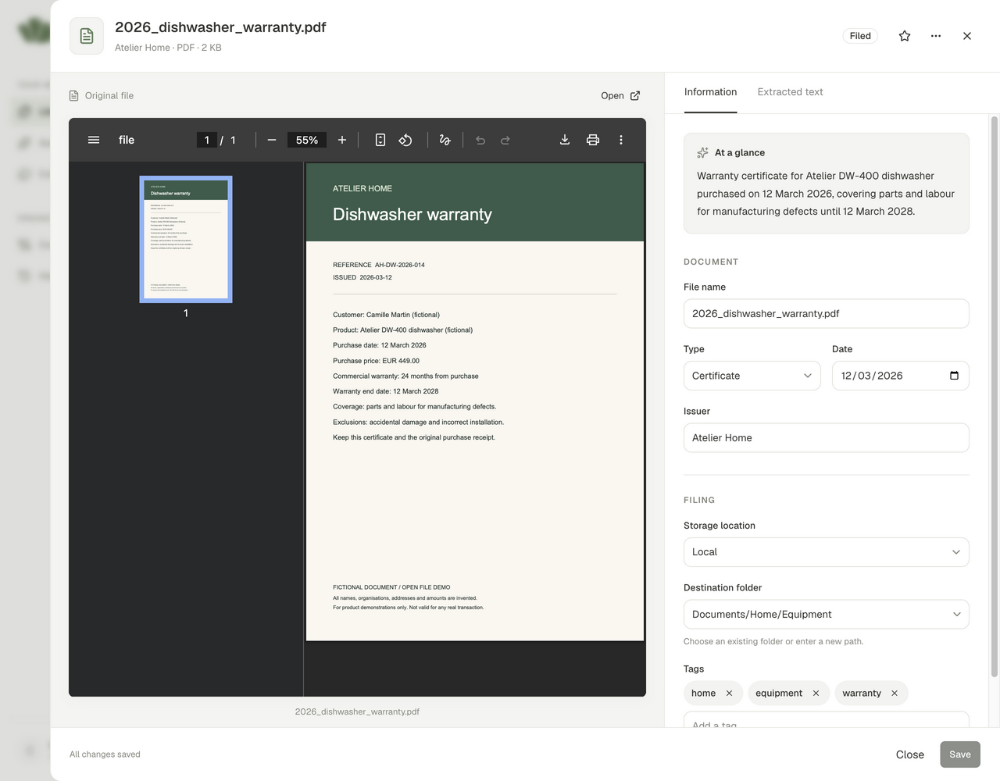
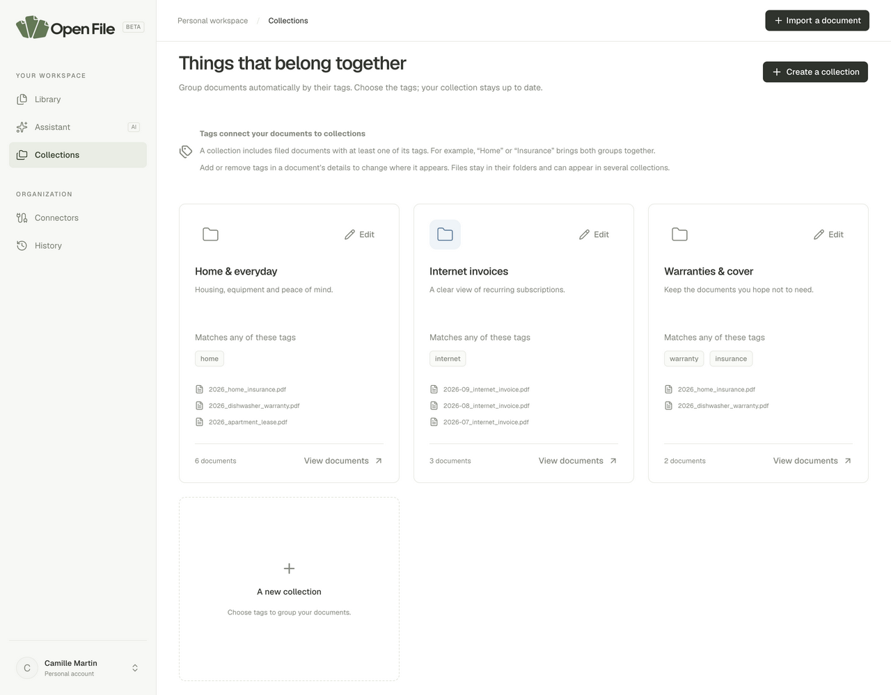

# Using Open File

[Back to README](../README.md)

The labels below match the English interface. Screenshots were taken in the
application using the [included fictional dataset](../examples/README.md).

## 1. Import and approve

Click **Import a document**, select up to five files, and choose **Local** or
**Google Drive**. Supported formats: PDF, PNG, JPEG, WebP, and UTF-8 TXT, with a
maximum of 20 MiB per file.

Without AI, choose **Import without AI**. With AI saved in settings, choose
**Import and analyze**. Wait for extraction and the suggestion, then check the
name, folder, storage, and metadata.

**Approve and file** files the document. Before this step, it remains among pending
imports and cannot be accessed by the assistant. **Resume later**, followed by
**Resume import**, lets you continue without uploading again.

A key or quota error requires correcting the settings and rerunning analysis.
If only embeddings fail, the document may still be eligible for approval with a
warning; text search remains available.

## 2. Browse the library

The library is the home page. Browse folders or show all documents, switch between
list and grid views, filter by type, storage, or text, and choose a sort order.
The library search field filters documents; the assistant provides conversational
document search.

Click a document to view its preview, summary, and metadata. Favorites provide
quick access to frequently used documents. **Suggest a new filing** reruns analysis
on a filed document: its previous location remains active until you approve the
new suggestion.

**Archive** removes the document from assistant searches without deleting its
original. Deletion removes the document from the workspace and schedules physical
file cleanup by the worker. It is not a recoverable trash folder.

## 3. Group documents into collections

A collection combines a name, description, color, and one or more tags. It shows
documents carrying **at least one** of those tags. A document can therefore appear
in several collections without duplicating the original.

Collection tags use OR matching. Multi-tag filters in the assistant's tools use
AND matching: their semantics differ.

## 4. Ask a question

Open **Assistant** and try questions such as:

- "When does my dishwasher warranty expire? Show the document."
- "What notice period does my lease specify? Cite the clause."
- "Find my three internet invoices from July to September 2026."
- "How many invoices are in my library?"

The activity panel shows the operations performed. Sources and cards open the
documents. Conversations are saved and can be resumed after reloading. You can
stop a response in progress. Changing the scope starts a new conversation.

Without AI, the same screen provides passages from text search without a generated
summary. With AI, check citations before relying on an answer. The assistant does
not file or delete documents. See [how it works](assistant.md).

## 5. Configure integrations

In **Settings**, choose manual or AI mode. Entering a key is not enough: click
**Save and enable AI**. Settings belong to the account; the key is not returned to
the browser after saving.

After enabling AI or changing the embedding model, rerun analysis on existing
documents to reindex them. Automatic naming can be replaced with a custom template.
Connector folders apply to subsequent imports.

**History** tracks imports, filing, and edits. Notification settings do not yet
correspond to an external notification delivery service.
